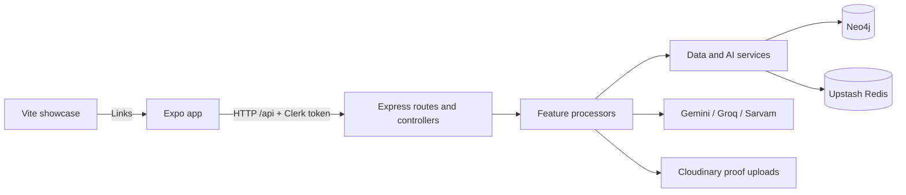

# PathFinder architecture

This describes the implementation on `main`, including the July 13 finalization and August Neo4j keepalive changes. The [history audit](maintenance/commit-history-audit.md) explains the earlier changes and the [maintenance guide](maintenance/README.md) records cleanup decisions and review rules.

## Applications and ownership

| Directory | Runtime | Responsibility |
| --- | --- | --- |
| `frontend/` | Expo Router, React Native, TypeScript | Mobile/web app, authentication, queries, journey submission, community and profiles |
| `backend/` | Express, TypeScript, Node.js | HTTP API, validation, AI processing and persistence |
| `LandingPage/` | React, Vite, JavaScript | Separately deployed public showcase site |

Each application has its own manifest and lockfile. The Expo landing route and Vite showcase are both active entrypoints with different authentication and deployment responsibilities.



## Backend boundaries

- `server.ts` mounts `/api/query`, `/api/output`, `/api/auth`, `/api/journey`, `/api/user` and `/api/community`. Routes select middleware and upload handling; controllers translate HTTP requests and responses.
- `processors/<feature>/` orchestrates use cases and validation. Journey schemas validate submissions; AI-specific schemas constrain provider responses.
- `services/` owns database retrieval, shared mappings, sessions and reusable AI operations. `journeyMapping.ts` maps both personal and public journey records.
- `ai/`, `config/` and `prompts/` contain provider adapters, configured clients, and prompts. `config/upstash.config.ts` is the shared Redis client.
- `db/` contains migration Cypher and seed journeys. `src/scripts/` contains explicitly invoked diagnostics, migration, import, embedding and keepalive tools.

Neo4j sessions are closed in `finally`; transaction-owning processors commit or roll back their own transactions. Submission spans several transactions and provider calls, so it is not an atomic transaction across all external services.

## Data and request contracts

The stored graph uses `User`, `Goal`, `Experience`, `Skill` and `Proof` nodes:

```text
User       -HAS_GOAL-------> Goal
User       -HAS_EXPERIENCE-> Experience
Experience -CONTRIBUTED_TO-> Goal
Experience -BUILT_SKILL----> Skill
Experience -HAS_PROOF------> Proof
Experience -TRANSITION-----> Experience
User       -UPVOTED--------> Experience
```

Transitions carry `decisionLabel`; they are relationships, not separate decision nodes. Submission dates use `MM YYYY`; writes convert them to Neo4j dates and retrieval serializes them as ISO date strings. Missing end dates mean ongoing.

Journey submission accepts JSON or multipart with one `proof` upload field. Manual and extracted goals have distinct input paths. Proof verification uses GitHub data or an uploaded image/PDF, Gemini, and Cloudinary. Preserve these wire contracts when changing code on either side of the API.

## Main flows

1. **Authentication:** Clerk issues the token; backend middleware resolves the Clerk user ID. Sync creates/updates a Neo4j user, followed by profile setup.
2. **Journey creation:** `/journey/start` creates a Redis session; `/journey/message` extracts a draft from the submitted narrative. The client reviews goals, experiences and proof metadata before submission. Processors validate duplicates, verify proofs, persist experiences, generate embeddings, infer transitions, update reputation and refresh the user's summary.
3. **Search:** Sarvam resolves optional voice input. Query understanding supplies topics, subtopics and focus. Retrieval intersects matching users' journeys with vector matches, expands the graph, ranks experiences, then aggregates matched-user statistics, timeline cards, Groq common patterns and Gemini insights.
4. **Output:** Separate authenticated endpoints translate insights and return WAV speech using Sarvam. These are distinct from the JSON API request helper.
5. **Community:** Public topic, subtopic, graph, feed, search and journey reads coexist with upvotes. Personal and public journey responses share record mappings while retaining their different identity fields and error handling.

Embeddings use `Xenova/bge-small-en-v1.5`, with the pipeline cached in process and vectors stored in Neo4j. Redis stores onboarding sessions with a 24-hour expiry. There is no active Upstash Workflow orchestration, Redis vector cache, or rate-limit middleware in this checkout.

## Frontend boundaries

`app/` contains Expo routes and layouts. The tabs are `ask`, `community`, `journey` and `profile`; other screens include results, sharing and `u/[username]`. Reusable UI lives under `components/`, never under the route directory.

`api/` owns request wrappers and response types. `apiFetch` handles authenticated JSON requests and errors; binary speech and platform-specific proof uploads keep their specialized transport paths. `utils/` holds shared transformations; `constants/colors.ts` defines the existing theme tokens.

`components/journey/ExpandableCards.tsx` is shared by the personal Journey tab and public profiles. `utils/journeyGraph.ts` creates Cytoscape elements and HTML for personal and public journey screens, preserving each screen's sizing and export behavior. The community SVG map uses `utils/communityGraph.ts` to group connected experiences into browsable paths and arrange their directed connections in columns. Unrelated paths are shown separately; branches, loops and isolated nodes remain available. This renderer is separate from the Cytoscape journey renderer.

Graph documents load Cytoscape and fonts from external URLs. Native WebView and browser iframe message bridges support node details; native audio, uploads, sharing, permissions and Expo configuration need device validation as well as TypeScript checks.
